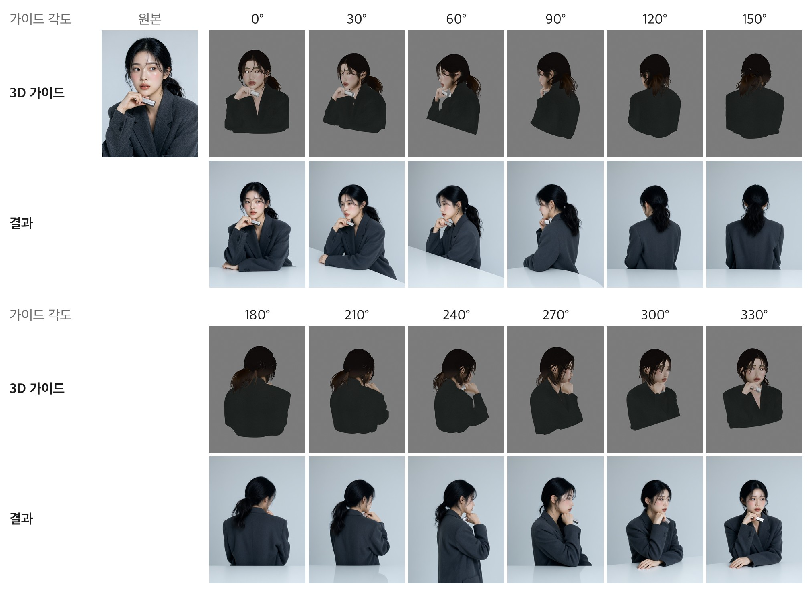
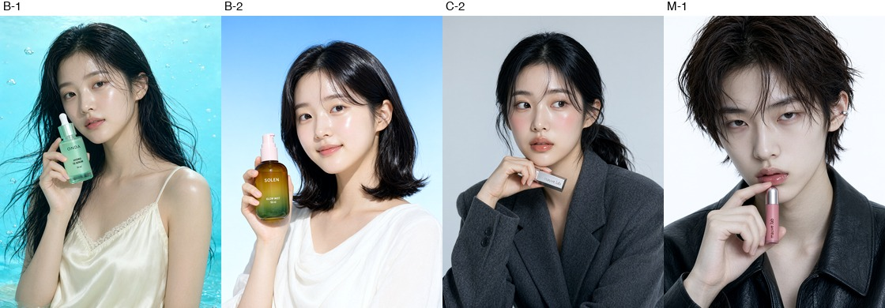
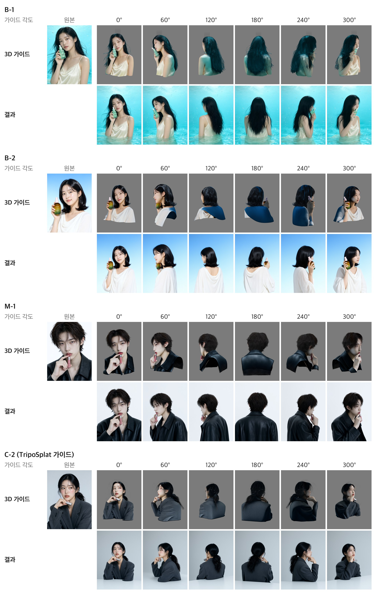
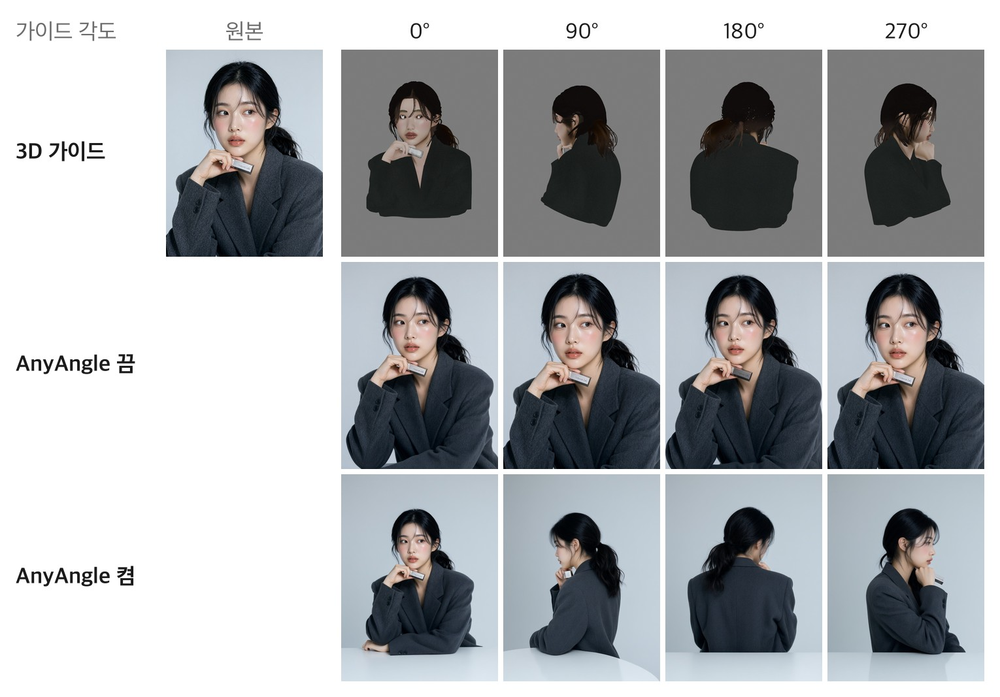
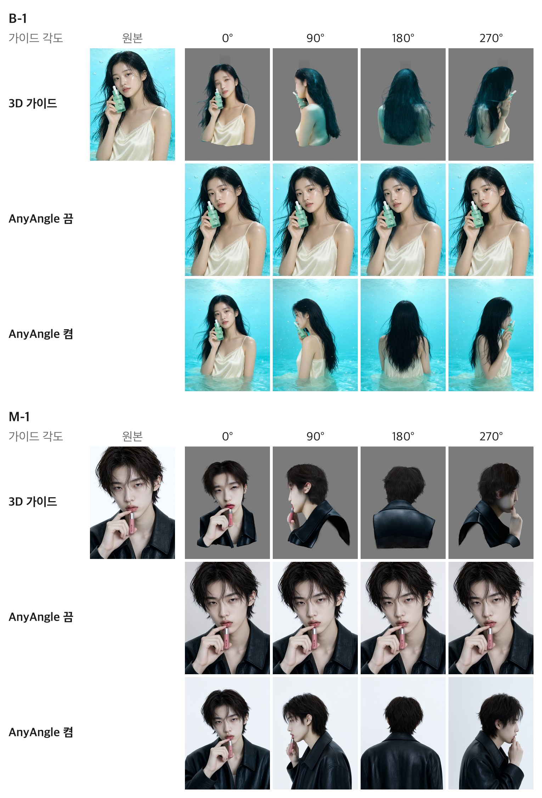
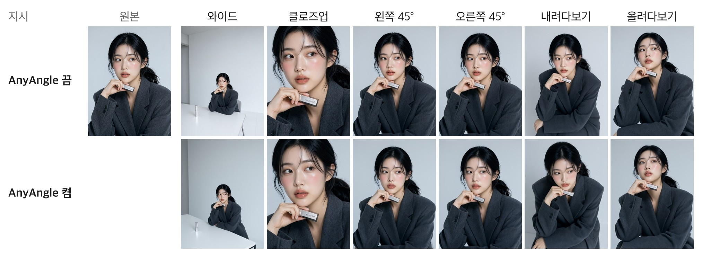

[English](README.md) · [한국어](README.ko.md) · [中文](README.zh-cn.md)

# image-editing-qwen-image-anyangle

Qwen-Image-2.1-Turbo에 AnyAngle LoRA를 얹어 사진의 카메라 각도를 바꿉니다. 원본 사진과 3D 모델로 렌더한 거친 가이드 이미지를 함께 받아, 원본을 가이드의 카메라 각도로 다시 그립니다.


## 빠른 시작

[model-compose](https://github.com/hanyeol/model-compose) 커밋 `51c7171c` 이후 버전이 필요합니다. 아직 PyPI에 릴리스되지 않아 GitHub에서 설치합니다.

[uv](https://docs.astral.sh/uv/)로 설치:

```bash
uv pip install "git+https://github.com/hanyeol/model-compose@51c7171c" python-multipart
```

또는 pip로 설치:

```bash
pip install "git+https://github.com/hanyeol/model-compose@51c7171c" python-multipart
```

이 저장소 클론:

```bash
git clone https://github.com/MindrLabs/image-editing-qwen-image-anyangle
cd image-editing-qwen-image-anyangle
```

실행:

```bash
PYTORCH_CUDA_ALLOC_CONF=expandable_segments:True model-compose up
```

24 GB GPU에 맞추려고 `expandable_segments`를 켭니다. 첫 실행 때 `Qwen/Qwen-Image-2.1-Turbo`(약 32.5 GB)와 AnyAngle LoRA(약 120 MB)를 내려받으며, 토큰은 필요 없습니다.

API 주소는 http://localhost:8096/api, Gradio UI 주소는 http://localhost:8097 입니다. 원본 사진과 가이드 두 장을 넣으며, 가이드는 [가이드 만들기](#가이드-만들기)를 따라 만듭니다.

## 요약

원본 사진과 3D 가이드를 함께 넣으면 Turbo + AnyAngle이 인물을 가이드 각도대로 한 바퀴 돌려 그립니다. 가이드 없이 글로만 지시하면 좌우로 거의 돌지 않습니다. 테이블 같은 소품은 각도마다 바뀌고, 제품 라벨은 깨질 수 있습니다.



그림 1 (RTX 4090, seed 42): 결과(아랫줄)가 3D 가이드(윗줄)의 각도를 따라 원본 인물을 한 바퀴 돌려 그립니다. 가이드는 3D 모델을 회색 배경에 렌더한 것이라 배경이 없고, 얼굴이 일그러져 있으며 전체가 어둡습니다. 결과에는 원본의 배경, 색, 얼굴이 돌아옵니다.

| 기기 | 상태 | 한 장 (초, 896×1184, 8스텝) | 최대 GPU 메모리 (MiB) |
| :---: | --- | --- | --- |
| RTX 4090 (bf16, 오프로드) | 측정 | 33 | 23845 |
| DGX Spark (bf16, 오프로드 없음) | 측정 | 22.6 | 44421 |
| Apple M2 16GB (nf4) | 중단 (메모리 부족) | — | — |

- 기기마다 돌릴 수 있는 설정으로 쟀습니다. 오프로드 없이 모델 전체를 올리면 44,421 MiB(DGX Spark 측정)라 RTX 4090의 24 GB에는 들어가지 않아 오프로드를 켰고, DGX Spark는 껐습니다. 두 시간은 같은 조건의 비교가 아닙니다.
- 최대 GPU 메모리는 RTX 4090에서는 GPU 전체 사용량이라 같은 GPU의 다른 프로세스 약 1,089 MiB가 들어 있습니다. DGX Spark는 통합 메모리라, nvidia-smi가 보여주는 이 서비스 프로세스의 사용량만 더했습니다.
- DGX Spark 결과는 RTX 4090과 각도와 구도가 같았습니다(C-2, TripoSplat 가이드 12각도, 픽셀 평균 차이 0\~255 기준 9.0\~15.3).

## 측정 환경

RTX 4090 한 장(24 GB)과 DGX Spark(GB10, 통합 메모리 128 GB)에서 Turbo 8스텝, `true_cfg_scale` 1, AnyAngle 강도 1.0, 출력 896×1184로 쟀습니다. RTX 4090에서는 24 GB 안에 들이려고 `PYTORCH_CUDA_ALLOC_CONF=expandable_segments:True`를 켰습니다. 두 기기 모두 다른 사용자와 함께 쓰는 기기입니다. 입력과 seed 수가 적어 통계 검정은 하지 않았고, 수치는 장별 값 또는 입력별 범위로 적습니다.

| ID | 내용 |
| :---: | --- |
| B-1 | 물속 배경, 인물 + 세럼 병 (ONDA) |
| B-2 | 하늘 배경, 인물 + 미스트 병 (SOLEN) |
| C-2 | 회색 배경, 인물 + 립스틱 (mauve.lab) |
| M-1 | 흰 배경, 남성 인물 + 립 틴트 (mauve.lab) |



그림 2: 입력 4개. 모두 Qwen-Image-2.1로 미리 만든 가상의 인물과 제품이며, 실제 인물 사진은 쓰지 않았습니다.

<details>
<summary>시험 구성과 지표</summary>

| 시험 | 조건 |
| :---: | --- |
| 3D 가이드 (RTX 4090) | 입력 4개 × 가이드 12각도 × seed 42. C-2, B-1, M-1은 0·90·180·270°에서 seed 7·123과 AnyAngle 끔을 더 돌렸습니다 |
| 3D 가이드 (DGX Spark) | C-2 × TripoSplat 가이드 12각도 × seed 42. 오프로드 켬은 0·30·60°만 돌렸습니다 |
| 글 지시 (RTX 4090) | 입력 4개 × 지시 6개 × seed 42, AnyAngle 켬·끔 |

| 지표 | 뜻 | 좋은 쪽 |
| :---: | --- | --- |
| 얼굴 좌우 각도 | 입력 얼굴 대비 좌우로 돈 각도. 가이드 시험은 가이드 방향과 같은 부호로, 글 지시는 왼쪽을 +로 적었습니다 | 가이드나 지시 각도에 가까울수록 |
| 얼굴 상하 각도 | 입력 얼굴 대비 상하 각도, 올려다보는 쪽이 + | 지시 방향으로 클수록 |
| 얼굴 유사도 | InsightFace(antelopev2) 얼굴 임베딩의 코사인 유사도, 입력 대비 | 높을수록. 옆모습은 같은 사람이어도 낮게 나옵니다 |
| 얼굴 크기 | 입력 대비 얼굴 상자 면적의 비 | 가이드 시험은 중립. 글 지시는 와이드에서 작을수록, 클로즈업에서 클수록 |
| 라벨 CER | RapidOCR로 읽은 제품 브랜드 글자(위 표의 괄호 안)의 글자 오류율, 0이 정확 | 낮을수록 |

</details>

<details>
<summary>가중치, 소프트웨어, 가이드 제작 상세</summary>

| 항목 | 내용 |
| :---: | --- |
| 가중치 | [Qwen/Qwen-Image-2.1-Turbo](https://huggingface.co/Qwen/Qwen-Image-2.1-Turbo/tree/fc13ba1986fcb905854dc8de2f52eee395f49b5b) + [lilylilith/QI_2.1_AnyAngle](https://huggingface.co/lilylilith/QI_2.1_AnyAngle/tree/5c8b4c8e05ba6328d54bf8d34ec724fef5a414ae) |
| LoRA 파일 | 키를 나눈 사본. 원본 파일과의 차이는 평균 픽셀 4.5\~6.8 (DGX Spark, C-2 4각도) |
| model-compose | RTX 4090: 커밋 `493b9db5`(Pixal3D 가이드, 글 지시), PyPI 0.4.125(TripoSplat 가이드) / DGX Spark: 커밋 `51c7171c` |
| 빠른 시작 재확인 | RTX 4090, 커밋 `51c7171c`와 원본 LoRA 파일, C-2 4각도: 같은 각도와 구도 (평균 픽셀 차이 6.8\~11.4) |
| DGX Spark 환경 | torch 2.13.0+cu130, diffusers 0.43.0, transformers 5.23.0, peft 0.21.3, 드라이버 580.126.09 |
| 가이드 3D | C-2: Pixal3D Mac 이식판(`raven38/pixal3d-sv-q8_0-v1`) / 입력 4개 모두: TripoSplat(코드 `d8db9e0`, 가중치 `56a96e6`) |
| 가이드 렌더 | 원본 시점부터 방위각 30° 간격, 회색 배경 |
| 시간 기준 | 서버를 띄운 뒤 두 번째 요청부터. 첫 요청은 모델 로드를 포함해 57\~388초 |

</details>

## 결과

| 주장 | 확인 방법 | 통과 |
| :---: | --- | --- |
| 얼굴이 가이드 각도를 따라 돕니다. | 얼굴 좌우 각도, 입력 4개 | ✓ |
| 한 바퀴 내내 인물, 옷, 머리 모양이 이어집니다. | 사람 판정 | ✓ |
| 가이드의 일그러진 얼굴이 결과에 남지 않습니다. | 사람 판정 (정면 가까운 각도 확대) | ✓ |
| 가이드에 없는 원본 배경이 다른 각도에도 옮겨집니다. | 사람 판정 (B-1 물속, B-2 하늘) | ✓ |
| AnyAngle이 있어야 가이드 각도를 따릅니다. | AnyAngle 켬·끔 비교 (C-2, B-1, M-1) | ✓ |
| seed를 바꿔도 같은 각도가 나옵니다. | seed 3개 비교 (C-2, B-1, M-1) | ✓ |
| 정면 가까운 각도에서 제품 라벨이 읽힙니다. | 라벨 CER (0·30·330°) | ✓ B-1, B-2, M-1 / ✗ C-2 |
| 테이블 같은 소품이 각도가 바뀌어도 유지됩니다. | 사람 판정 (C-2) | ✗ |
| 글 지시만으로 좌우 45° 회전이 됩니다. | 얼굴 좌우 각도, AnyAngle 켬·끔 | ✗ 켬에서도 최대 14° (M-1) |
| 와이드, 클로즈업, 내려다보기, 올려다보기는 Turbo만으로도 됩니다. | 얼굴 크기, 상하 각도 | ✓ 내려다보기는 B-1에서 −2°로 약함 |

### 가이드 각도를 따르는가

따릅니다. 그림 1의 C-2에서 얼굴은 30°와 330°에서 약 1°, 60°와 300°에서 2\~5°, 90°에서 15° 덜 돌았고, 270°는 seed 3개에서 85\~90°였습니다.

- 출력 구도는 가이드를 따라 입력보다 멀어집니다. 정면(0°)에서도 얼굴 크기가 0.39\~0.44배이고 테이블과 팔이 화면에 들어옵니다.
- 테이블은 0\~60°에서 각진 모서리, 90°에서 둥근 상판으로 바뀝니다. 입력과 가이드 어디에도 없어서 모델이 각도마다 새로 그린 것입니다.
- 손에 든 제품의 라벨은 한 바퀴 내내 읽히지 않습니다(CER 0.89\~1.00). AnyAngle을 끈 4장은 구도가 입력에 가깝고(얼굴 크기 0.77\~1.0배) CER이 0\~0.11이었습니다.
- 정면 얼굴은 확대해 보아도 가이드의 일그러진 눈이 남지 않았습니다. 피부 광택은 원본보다 덜합니다.

<details>
<summary>수치: C-2 가이드 각도별 얼굴과 라벨</summary>

| 가이드 각도 | 얼굴 좌우 각도 | 얼굴 유사도 | 얼굴 크기 | 라벨 CER |
| :---: | --- | --- | --- | --- |
| 0° | 0.0° | 0.91 | 0.39배 | 1.00 |
| 30° | 28.9° | 0.71 | 0.33배 | 1.00 |
| 60° | 55.3° | 0.59 | 0.28배 | 1.00 |
| 90° | 75.0° | 0.29 | 0.18배 | 1.00 |
| 270° (−90°) | −84.9° | 0.55 | 0.29배 | 1.00 |
| 300° (−60°) | −57.9° | 0.65 | 0.33배 | 0.89 |
| 330° (−30°) | −28.8° | 0.80 | 0.35배 | 1.00 |

각 칸은 C-2 seed 42 한 장의 값입니다. 뒷모습(120\~240°)은 얼굴을 찾지 못하거나 값이 흔들려 뺐습니다.

</details>

### 다른 사진에서도 되는가

됩니다. B-1, B-2, M-1은 TripoSplat 가이드로 돌렸고, C-2도 TripoSplat으로 한 번 더 돌려 Pixal3D 가이드(그림 1)와 비교했습니다. 레시피와 출력 크기는 같습니다.



그림 3 (RTX 4090, seed 42): 입력마다 윗줄은 TripoSplat 가이드, 아랫줄은 결과입니다. 60° 간격만 실었습니다. 스플랫 가이드는 Pixal3D 가이드보다 원본 색이 많이 남아 있습니다.

- 가이드에 없는 B-1의 물빛과 B-2의 하늘이 한 바퀴 내내 옮겨졌습니다. 다만 B-1은 원본의 물속 장면이 허리까지 물에 잠겨 선 장면으로 바뀌었습니다.
- B-2의 가이드는 뒷모습에서 흰 상의가 파랗게 렌더됐지만, 결과는 흰 상의를 유지했습니다.
- B-1, B-2, M-1은 0°에서 이미 6\~8° 반대쪽으로 돌아 있습니다. B-1과 M-1은 seed 3개에서 같은 치우침이 나와 무작위 흔들림은 아닙니다.
- 90°는 세 입력에서 61\~70°로, C-2(74\~76°)보다 덜 돌았습니다.
- 라벨은 세 입력에서 0·30·330°에 브랜드 글자가 거의 그대로 읽혔고, B-1과 B-2의 용량 같은 작은 글자는 뭉개졌습니다. C-2는 두 가이드 모두에서 라벨이 깨졌습니다(CER 0.56\~1.00).
- C-2에서 두 가이드의 결과는 얼굴 각도가 1\~8° 안에서 달랐습니다. 입력 한 장의 비교입니다.

<details>
<summary>수치: 입력별 가이드 각도와 얼굴, 라벨</summary>

| 가이드 각도 | B-1 | B-2 | M-1 | C-2 (TripoSplat) | C-2 (Pixal3D) |
| :---: | --- | --- | --- | --- | --- |
| 0° | −7.6° | −6.9° | −6.1° | 2.2° | 0.0° |
| 30° | 12.8° | 27.3° | 22.2° | 35.1° | 28.9° |
| 60° | 42.5° | 54.7° | 51.4° | 58.7° | 55.3° |
| 90° | 62.2° | 61.3°† | 66.1° | 76.3°† | 75.0° |
| 270° (−90°) | −104.0°† | −103.7° | −96.4° | −77.3° | −84.9° |
| 300° (−60°) | −75.3° | −73.8° | −65.4° | −51.0° | −57.9° |
| 330° (−30°) | −33.3° | −40.7° | −30.5° | −26.1° | −28.8° |

| 입력 (라벨) | 라벨 CER 0° / 30° / 330° | 0° 얼굴 크기 |
| :---: | --- | --- |
| B-1 (ONDA) | 0.00 / 0.00 / 0.00 | 0.52배 |
| B-2 (SOLEN) | 0.00 / 0.00 / 0.00 | 0.45배 |
| M-1 (mauve.lab) | 0.00 / 0.33 / 0.00 | 0.52배 |
| C-2, TripoSplat (mauve.lab) | 0.56 / 1.00 / 1.00 | 0.40배 |
| C-2, Pixal3D (mauve.lab) | 1.00 / 1.00 / 1.00 | 0.39배 |

각 칸은 seed 42 한 장의 값입니다. 뒷모습인 120\~240°는 뺐습니다. †는 상하 각도가 ±45°를 넘어 옆얼굴에서 추정이 흔들렸을 수 있는 값입니다. 0·30·330·300°를 원본 크기로 확대해 보면 세 입력 모두 원본의 얼굴과 머리 모양이 이어졌습니다.

</details>

### AnyAngle이 꼭 필요한가

필요합니다. AnyAngle을 끄면 가이드가 돌아가도 결과는 정면 그대로입니다(RTX 4090). C-2, B-1, M-1 모두 얼굴 좌우 각도가 0.6° 안이고 얼굴 유사도가 0.92\~0.96으로, 원본을 거의 그대로 다시 그렸습니다. 켜면 seed 42, 7, 123이 같은 각도로 돌았습니다(차이 5° 안).



그림 4 (RTX 4090, seed 42): C-2. 가이드는 돌아가지만 AnyAngle을 끈 줄은 정면 그대로이고, 켠 줄만 가이드 각도를 따릅니다.

<details>
<summary>B-1, M-1 그림과 seed별 수치</summary>



그림 5 (RTX 4090, seed 42): 그림 4와 같은 시험을 TripoSplat 가이드로 B-1과 M-1에 했습니다.

| 조건 | C-2 | B-1 | M-1 |
| :---: | --- | --- | --- |
| AnyAngle 켬, 0° | −1.2\~0.0° | −7.6\~−6.1° | −7.3\~−6.1° |
| AnyAngle 켬, 90° | 73.5\~75.0° | 62.2\~65.2°† | 66.1\~69.8° |
| AnyAngle 켬, 270° | −89.7\~−84.9° | −104.0\~−101.5°† | −96.4\~−94.5° |
| AnyAngle 끔, 4각도 | −0.5\~0.0° | 0.2\~0.6° | 0.1\~0.3° |
| AnyAngle 끔, 얼굴 유사도 | 0.93\~0.95 | 0.92\~0.95 | 0.95\~0.96 |

켬은 seed 42·7·123의 범위, 끔은 seed 42에서 0·90·180·270°의 범위입니다. 켬의 180°는 뒷모습이라 얼굴이 없습니다.

</details>

### 가이드 없이 글로만 지시하면

와이드, 클로즈업, 내려다보기, 올려다보기는 Turbo만으로 되지만, 좌우 45° 회전은 AnyAngle을 켜도 거의 되지 않습니다. 원본 한 장과 글 지시만 넣은 시험이며, AnyAngle 카드의 사용법은 아닙니다.



그림 6 (RTX 4090, seed 42): C-2. 윗줄은 AnyAngle 끔, 아랫줄은 켬입니다. 왼쪽·오른쪽 45° 지시에서는 켜도 거의 돌지 않습니다.

- 왼쪽 45°에서 AnyAngle을 켜면 M-1만 14° 돌고 나머지 3개는 6° 안입니다.
- 내려다보기는 AnyAngle 끔에서 B-1이 −2°로 약했습니다. 켜면 B-1 −7°, B-2 −12°, C-2 −15°로 끌 때보다 더 내려다봤고, M-1은 −11°와 −10°로 비슷했습니다.
- C-2 와이드는 켬·끔 모두 입력에 없던 테이블과 립스틱 하나가 더 생겼습니다.

<details>
<summary>지시 문구와 수치</summary>

문구는 중국어에 영어 번역을 붙인 6개입니다.

| 지시 | 문구 |
| :---: | --- |
| 와이드 | `将镜头转为广角镜头 Turn the camera to a wide-angle lens.` |
| 클로즈업 | `将镜头转为特写镜头 Turn the camera to a close-up.` |
| 왼쪽 45° | `将镜头向左旋转45度 Rotate the camera 45 degrees to the left.` |
| 오른쪽 45° | `将镜头向右旋转45度 Rotate the camera 45 degrees to the right.` |
| 내려다보기 | `将镜头向上移动，俯视角度 Move the camera upwards to a bird's-eye view.` |
| 올려다보기 | `将镜头向下移动，仰视角度 Move the camera down to a low-angle view.` |

각 칸은 입력 4개(B-1, B-2, C-2, M-1)의 seed 42 범위입니다.

| 지시 | 측정 | Turbo | Turbo + AnyAngle |
| :---: | --- | --- | --- |
| 와이드 | 얼굴 크기 | 0.07\~0.17배 | 0.10\~0.18배 |
| 클로즈업 | 얼굴 크기 | 1.7\~2.6배 | 1.6\~2.6배 |
| 왼쪽 45° | 좌우 각도 | −0.4\~+2.5° | −2\~+14° |
| 오른쪽 45° | 좌우 각도 | −0.2\~−5° | −2\~−6° |
| 내려다보기 | 상하 각도 | −2\~−11° | −7\~−15° |
| 올려다보기 | 상하 각도 | +7\~+28° | +7\~+20° |
| 왼쪽 45° | 얼굴 유사도 | 0.93\~0.95 | 0.87\~0.93 |

</details>

## 추천

- 원하는 각도나 360° 회전이 필요하면 원본을 3D로 만들어 가이드를 렌더하고 Turbo + AnyAngle을 씁니다. AnyAngle은 강도 1.0으로 켜고 이미지는 `[원본, 가이드]` 순서(`source`, `guide`)로 넣습니다.
- 가이드용 3D는 TripoSplat(RTX 4090에서 입력당 9\~11초)으로 만들어도 입력 4개 모두 가이드 각도를 따랐습니다. Pixal3D와는 C-2 한 장으로만 비교했습니다.
- DGX Spark처럼 메모리를 함께 쓰는 기기에서는 `model-compose.yml`의 `cpu_offload: model` 줄을 지웁니다. 결과는 같고 장당 시간이 196\~267초에서 22.6초로 줄었습니다.

## 가이드 만들기

가이드는 원본 사진을 3D로 만든 뒤 원하는 각도에서 렌더한 이미지입니다. 3D는 [TripoSplat](https://github.com/VAST-AI-Research/TripoSplat)이나 [Pixal3D](https://github.com/MindrLabs/image-to-3d-pixal3d/blob/main/README.ko.md)로 만들 수 있고, 이 리포트는 둘 다 썼습니다. 렌더는 Blender 같은 도구로 하되 아래 조건을 맞춥니다.

| 조건 | 내용 |
| :---: | --- |
| 비율 | 원본 사진과 같은 비율. 이 리포트는 긴 변 1024 픽셀로 렌더했습니다 |
| 0° | 원본 사진과 같은 시점 |
| 배경 | 회색 단색 |
| 카메라 | 50 mm 렌즈(36 mm 센서), 물체가 화면의 약 80% |

요청 예시 (원본 + 가이드):

```bash
curl -o out.png localhost:8096/api/workflows/runs \
  -F workflow_id=generate -F wait_for_completion=true -F output_only=true \
  -F "input.source=@photo.png;type=application/octet-stream" \
  -F "input.guide=@guide.png;type=application/octet-stream" \
  -F input.width=896 -F input.height=1184 -F input.seed=42
```

`source`에 원본, `guide`에 가이드를 넣습니다. 출력 크기를 지정하지 않으면 가이드의 비율을 따르므로, 원본에 맞춰 `width`, `height`를 넣습니다. 기본 프롬프트는 LoRA 카드의 `Change the camera angle from <image2> to <image1>.`입니다.

## 한계와 측정하지 않은 것

### 모델의 한계

- 가이드가 꼭 필요합니다. 글 지시만으로는 좌우 45° 회전이 거의 되지 않아(AnyAngle을 켜도 최대 14°), 원본을 3D로 만드는 단계가 따로 듭니다.
- 옆으로 갈수록 덜 돕니다. 90° 가이드에서 얼굴은 61\~76°까지만 돌았습니다.
- 가이드에 없는 것은 각도마다 새로 그립니다. C-2의 테이블 모양이 바뀌고, B-1의 물속 장면은 허리까지 물에 잠긴 장면이 됐습니다.
- 손에 든 제품의 라벨이 깨질 수 있습니다. C-2는 측정한 모든 각도에서 제대로 읽히지 않았고(CER 0.56\~1.00), B-1과 B-2의 작은 글자는 뭉개졌습니다.
- 메모리를 많이 씁니다. 24 GB 카드를 거의 다 쓰고(23,845 MiB, 다른 프로세스 포함), 16 GB Mac에서는 nf4로도 불러오지 못했습니다.

### 측정하지 않은 것

- 일반 Qwen-Image-2.1(20스텝)은 RTX 4090 24 GB에서 첫 스텝 중 GPU 메모리 할당이 실패해 한 장도 만들지 못했습니다. 그래서 LoRA 카드가 가장 좋다고 한 설정(CFG 3, 20스텝 이상)과는 비교하지 못했습니다.
- 입력이 모두 생성 이미지라 카메라로 찍은 사진에서도 같은지는 확인하지 않았습니다.

### 확인하지 않은 모델 카드 주장

[AnyAngle LoRA 카드](https://huggingface.co/lilylilith/QI_2.1_AnyAngle/blob/5c8b4c8e05ba6328d54bf8d34ec724fef5a414ae/README.md):

- 일반 Qwen-Image-2.1에서 CFG 3, 20스텝 이상일 때 결과가 가장 좋습니다.
- Turbo 모델이나 Turbo LoRA를 쓰면 속도는 빨라지지만 품질이 조금 떨어집니다.
- 작성자는 가이드를 Tripo Splat(가우시안 스플랫)이나 Trellis2(3D 모델)로 만들었고, 다른 스플랫·3D 생성기도 됩니다. 이 리포트는 TripoSplat(입력 4개)과 카드가 다른 생성기의 예로 든 Pixal3D(C-2)를 썼고, Trellis2는 쓰지 않았습니다.
- 실사뿐 아니라 일러스트와 스케치 그림체도 각도를 바꿀 수 있습니다.
- 3D 모델이 공간을 잘못 잡거나 너무 거칠면(해부 구조나 얼굴이 심하게 일그러지면) 소품 배치가 틀어지고, 얼굴이 뚜렷하지 않거나 해상도가 낮으면 얼굴이 망가질 수 있습니다. (이 리포트에서는 C-2의 테이블이 각도마다 바뀌었고, 가이드의 일그러진 얼굴은 입력 4개 모두 결과에 남지 않았습니다.)

## 라이선스

| 대상 | 라이선스 | 상업적 이용 |
| :---: | --- | :---: |
| 이 서비스 | [`LICENSE`](LICENSE) | ✓ |
| Qwen/Qwen-Image-2.1-Turbo 가중치 | [Qwen Research License](https://huggingface.co/Qwen/Qwen-Image-2.1-Turbo/blob/fc13ba1986fcb905854dc8de2f52eee395f49b5b/LICENSE) | ✗ |
| lilylilith/QI_2.1_AnyAngle LoRA | [Apache-2.0](https://huggingface.co/lilylilith/QI_2.1_AnyAngle/blob/5c8b4c8e05ba6328d54bf8d34ec724fef5a414ae/README.md) | ✓ |
| 가이드 3D 모델 생성: Pixal3D Mac 이식판 [`pixal3d.cpp`](https://github.com/raven38/pixal3d.cpp)와 `raven38/pixal3d-sv-q8_0-v1` | MIT, 가중치 중 `dinov3.gguf`만 DINOv3 License | 이식판 ✓, DINOv3는 확인하지 않았습니다 |
| 가이드 3D 생성: [TripoSplat](https://github.com/VAST-AI-Research/TripoSplat/tree/d8db9e018b413dd9c4a9fe22463781bf98e8e68d)과 [`VAST-AI/TripoSplat`](https://huggingface.co/VAST-AI/TripoSplat/tree/56a96e603204ec410c4da60c13ea4fa09a2169a9) 가중치 | MIT. 가중치 묶음 안의 DINOv3 인코더와 FLUX.2 VAE는 각자 라이선스가 있습니다 | 코드 ✓, 묶음 안 개별 가중치는 확인하지 않았습니다 |

AnyAngle LoRA는 Apache-2.0이지만 베이스 가중치가 비상업 라이선스라 Turbo + AnyAngle 조합의 상업적 이용은 베이스 라이선스를 따릅니다. 입력 이미지는 [Qwen Research License](https://huggingface.co/Qwen/Qwen-Image-2.1/blob/d26bb61231c349cf6b7896fa83353113880e1ba3/LICENSE)인 Qwen-Image-2.1로 만들었습니다. 가이드용 3D 모델은 이 서비스에 들어 있지 않고 따로 만듭니다. 공식 Pixal3D 파이프라인은 배경 제거에 비상업 전용 모델을 쓰므로, 다른 경로의 라이선스는 [Pixal3D 리포트의 라이선스 절](https://github.com/MindrLabs/image-to-3d-pixal3d/blob/main/README.ko.md#라이선스)을 봅니다.
