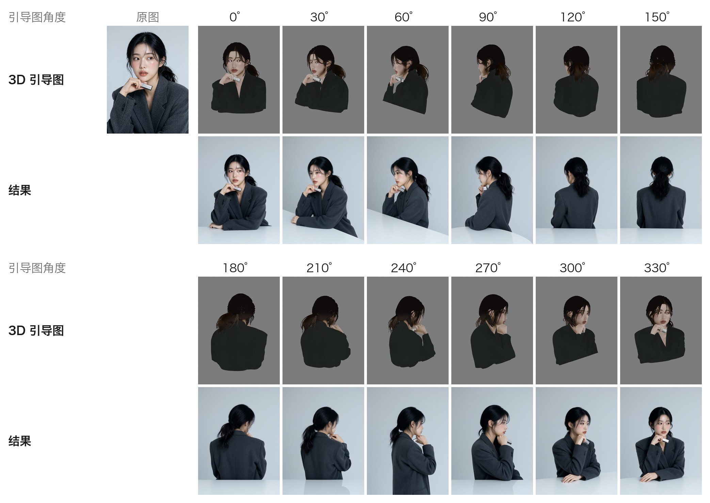
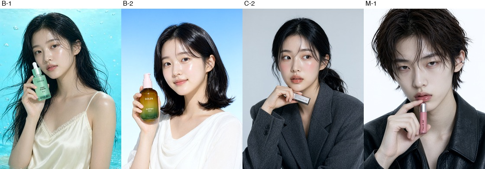
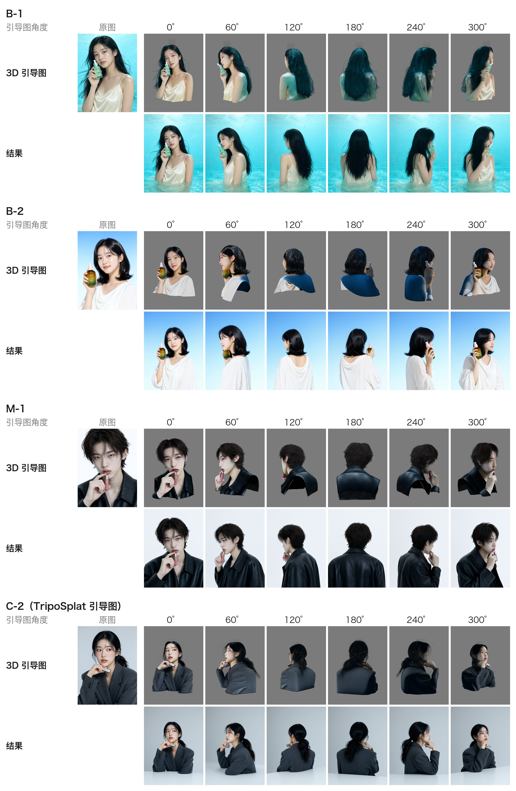
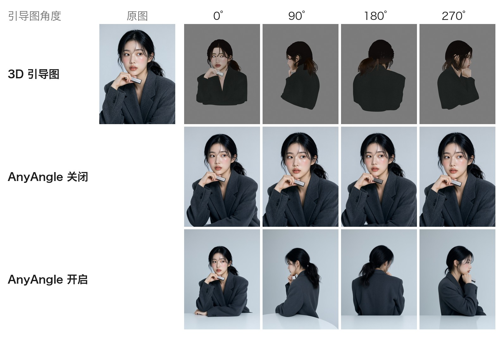
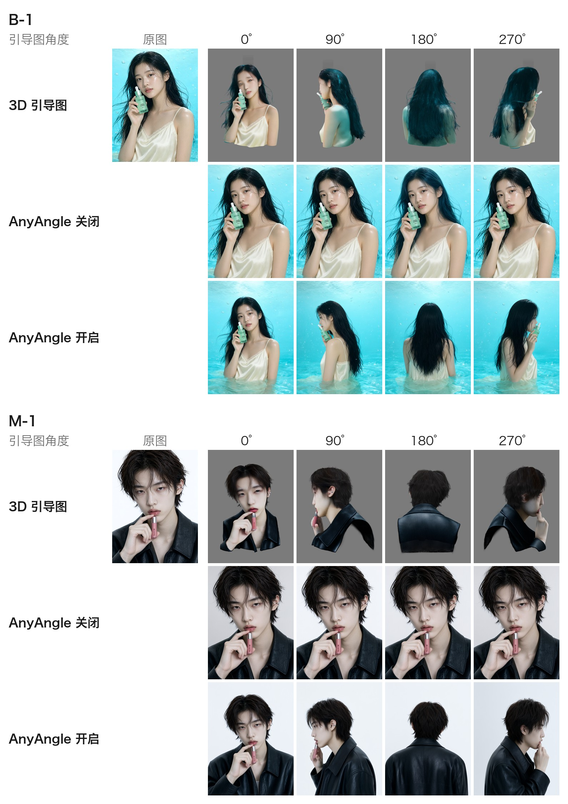
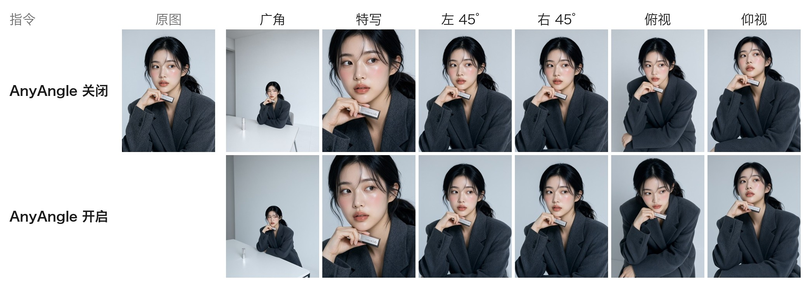

[English](README.md) · [한국어](README.ko.md) · [中文](README.zh-cn.md)

# image-editing-qwen-image-anyangle

这个服务在 Qwen-Image-2.1-Turbo 上加载 AnyAngle LoRA，用来改变照片的拍摄角度。它同时接收原图和一张由 3D 模型渲染出的粗糙引导图，按引导图的相机角度把原图重新画出来。


## 快速开始

需要 [model-compose](https://github.com/hanyeol/model-compose) 提交 `51c7171c` 或更新的版本。该版本尚未发布到 PyPI，因此从 GitHub 安装。

用 [uv](https://docs.astral.sh/uv/) 安装：

```bash
uv pip install "git+https://github.com/hanyeol/model-compose@51c7171c" python-multipart
```

或用 pip 安装：

```bash
pip install "git+https://github.com/hanyeol/model-compose@51c7171c" python-multipart
```

克隆本仓库：

```bash
git clone https://github.com/MindrLabs/image-editing-qwen-image-anyangle
cd image-editing-qwen-image-anyangle
```

运行：

```bash
PYTORCH_CUDA_ALLOC_CONF=expandable_segments:True model-compose up
```

开启 `expandable_segments` 是为了放进 24 GB 显卡。首次运行会下载 `Qwen/Qwen-Image-2.1-Turbo`（约 32.5 GB）和 AnyAngle LoRA（约 120 MB），不需要 token。

API 地址为 http://localhost:8096/api，Gradio UI 地址为 http://localhost:8097 。输入原图和引导图两张，引导图按[制作引导图](#制作引导图)制作。

## 摘要

同时输入原图和 3D 引导图，Turbo + AnyAngle 会按引导图的角度把人物转一整圈画出来。不给引导图、只用文字指令时，左右几乎转不动。桌子等道具会随角度变化，商品标签也可能损坏。



图 1（RTX 4090，seed 42）：结果（下排）跟随 3D 引导图（上排）的角度，把原图人物转了一整圈。引导图是把 3D 模型渲染在灰色背景上得到的，所以没有背景，脸部变形，整体偏暗。结果中原图的背景、颜色和脸部都恢复了。

| 设备 | 状态 | 一张（秒，896×1184，8 步） | GPU 显存峰值（MiB） |
| :---: | --- | --- | --- |
| RTX 4090（bf16，卸载） | 已测量 | 33 | 23845 |
| DGX Spark（bf16，不卸载） | 已测量 | 22.6 | 44421 |
| Apple M2 16GB（nf4） | 中止（内存不足） | — | — |

- 每台设备用它能跑的设置测量。不卸载、把整个模型放进显存需要 44,421 MiB（DGX Spark 实测），RTX 4090 的 24 GB 放不下，所以开启了卸载；DGX Spark 则关闭。两个时间不是同条件的比较。
- RTX 4090 的 GPU 显存峰值是整块 GPU 的用量，包含同一块 GPU 上其他进程的约 1,089 MiB。DGX Spark 是统一内存，只累加了 nvidia-smi 显示的本服务进程的用量。
- DGX Spark 的结果在角度和构图上与 RTX 4090 相同（C-2，12 个角度的 TripoSplat 引导图，平均像素差按 0\~255 计为 9.0\~15.3）。

## 测量环境

在一块 RTX 4090（24 GB）和 DGX Spark（GB10，统一内存 128 GB）上，以 Turbo 8 步、`true_cfg_scale` 1、AnyAngle 强度 1.0、输出 896×1184 测量。RTX 4090 上为了放进 24 GB，开启了 `PYTORCH_CUDA_ALLOC_CONF=expandable_segments:True`。两台都是与其他用户共用的设备。输入和 seed 数量少，没有做统计检验，数值按单张值或各输入的范围列出。

| ID | 内容 |
| :---: | --- |
| B-1 | 水中背景，人物 + 精华液瓶（ONDA） |
| B-2 | 天空背景，人物 + 喷雾瓶（SOLEN） |
| C-2 | 灰色背景，人物 + 口红（mauve.lab） |
| M-1 | 白色背景，男性人物 + 唇釉（mauve.lab） |



图 2：4 个输入。全部是事先用 Qwen-Image-2.1 生成的虚构人物和商品，没有使用真人照片。

<details>
<summary>测试组成与指标</summary>

| 测试 | 条件 |
| :---: | --- |
| 3D 引导图（RTX 4090） | 4 个输入 × 12 个引导图角度 × seed 42。C-2、B-1、M-1 在 0·90·180·270° 上另外跑了 seed 7·123 和 AnyAngle 关闭 |
| 3D 引导图（DGX Spark） | C-2 × 12 个 TripoSplat 引导图角度 × seed 42。开启卸载只跑了 0·30·60° |
| 文字指令（RTX 4090） | 4 个输入 × 6 条指令 × seed 42，AnyAngle 开启与关闭 |

| 指标 | 含义 | 更好的方向 |
| :---: | --- | --- |
| 脸部左右角度 | 相对输入脸部左右转动的角度。引导图测试与引导方向取相同符号，文字指令以向左为 + | 越接近引导图或指令角度 |
| 脸部上下角度 | 相对输入脸部的上下角度，仰视方向为 + | 在指令方向上越大 |
| 脸部相似度 | InsightFace（antelopev2）脸部嵌入与输入的余弦相似度 | 越高。侧脸即使是同一人也会偏低 |
| 脸部大小 | 脸部框面积与输入之比 | 引导图测试中为中性。文字指令中，广角越小、特写越大 |
| 标签 CER | 用 RapidOCR 读出的商品品牌文字（上表括号内）的字符错误率，0 为完全正确 | 越低 |

</details>

<details>
<summary>权重、软件与引导图制作详情</summary>

| 项目 | 内容 |
| :---: | --- |
| 权重 | [Qwen/Qwen-Image-2.1-Turbo](https://huggingface.co/Qwen/Qwen-Image-2.1-Turbo/tree/fc13ba1986fcb905854dc8de2f52eee395f49b5b) + [lilylilith/QI_2.1_AnyAngle](https://huggingface.co/lilylilith/QI_2.1_AnyAngle/tree/5c8b4c8e05ba6328d54bf8d34ec724fef5a414ae) |
| LoRA 文件 | 拆分键的副本。与原始文件的差异为平均像素差 4.5\~6.8（DGX Spark，C-2 4 个角度） |
| model-compose | RTX 4090：提交 `493b9db5`（Pixal3D 引导图、文字指令），PyPI 0.4.125（TripoSplat 引导图）/ DGX Spark：提交 `51c7171c` |
| 快速开始复查 | RTX 4090，提交 `51c7171c` 与原始 LoRA 文件，C-2 4 个角度：角度和构图相同（平均像素差 6.8\~11.4） |
| DGX Spark 环境 | torch 2.13.0+cu130，diffusers 0.43.0，transformers 5.23.0，peft 0.21.3，驱动 580.126.09 |
| 引导图 3D | C-2：Pixal3D Mac 移植版（`raven38/pixal3d-sv-q8_0-v1`）/ 全部 4 个输入：TripoSplat（代码 `d8db9e0`，权重 `56a96e6`） |
| 引导图渲染 | 从原图视角起按方位角 30° 间隔，灰色背景 |
| 时间基准 | 启动服务器后从第二个请求起。第一个请求包括模型加载，耗时 57\~388 秒 |

</details>

## 结果

| 主张 | 确认方法 | 通过 |
| :---: | --- | --- |
| 脸部跟随引导图角度转动。 | 脸部左右角度，4 个输入 | ✓ |
| 转一整圈，人物、衣服、发型始终连贯。 | 目视判定 | ✓ |
| 引导图中变形的脸不会留在结果里。 | 目视判定（放大接近正面的角度） | ✓ |
| 引导图中没有的原图背景会带到其他角度。 | 目视判定（B-1 水中，B-2 天空） | ✓ |
| 只有加上 AnyAngle 才会跟随引导图角度。 | AnyAngle 开启与关闭对比（C-2、B-1、M-1） | ✓ |
| 换 seed 也得到相同的角度。 | 3 个 seed 对比（C-2、B-1、M-1） | ✓ |
| 在接近正面的角度能读出商品标签。 | 标签 CER（0·30·330°） | ✓ B-1、B-2、M-1 / ✗ C-2 |
| 桌子等道具在角度变化时保持不变。 | 目视判定（C-2） | ✗ |
| 只用文字指令就能左右转 45°。 | 脸部左右角度，AnyAngle 开启与关闭 | ✗ 开启也最多 14°（M-1） |
| 广角、特写、俯视、仰视只用 Turbo 就能做到。 | 脸部大小，上下角度 | ✓ 俯视在 B-1 上只有 −2°，偏弱 |

### 是否跟随引导图角度

跟随。在图 1 的 C-2 中，脸部在 30° 和 330° 少转约 1°，在 60° 和 300° 少转 2\~5°，在 90° 少转 15°；270° 在 3 个 seed 中为 85\~90°。

- 输出构图跟随引导图，比输入拉得更远。即使在正面（0°），脸部大小也为 0.39\~0.44 倍，桌子和手臂进入画面。
- 桌子在 0\~60° 是有棱角的边，到 90° 变成圆形桌面。输入和引导图里都没有桌子，是模型在每个角度重新画的。
- 手中商品的标签转一整圈都读不出来（CER 0.89\~1.00）。关闭 AnyAngle 的 4 张构图接近输入（脸部大小 0.77\~1.0 倍），CER 为 0\~0.11。
- 放大看正面的脸，引导图中变形的眼睛没有留下。皮肤光泽比原图弱。

<details>
<summary>数值：C-2 各引导图角度的脸部与标签</summary>

| 引导图角度 | 脸部左右角度 | 脸部相似度 | 脸部大小 | 标签 CER |
| :---: | --- | --- | --- | --- |
| 0° | 0.0° | 0.91 | 0.39 倍 | 1.00 |
| 30° | 28.9° | 0.71 | 0.33 倍 | 1.00 |
| 60° | 55.3° | 0.59 | 0.28 倍 | 1.00 |
| 90° | 75.0° | 0.29 | 0.18 倍 | 1.00 |
| 270°（−90°） | −84.9° | 0.55 | 0.29 倍 | 1.00 |
| 300°（−60°） | −57.9° | 0.65 | 0.33 倍 | 0.89 |
| 330°（−30°） | −28.8° | 0.80 | 0.35 倍 | 1.00 |

每格是 C-2 seed 42 一张的值。背面（120\~240°）没有检测到脸或数值不稳定，已排除。

</details>

### 换一张照片也行吗

行。B-1、B-2、M-1 用 TripoSplat 引导图转动，C-2 也用 TripoSplat 再转一次，与 Pixal3D 引导图（图 1）对比。配方和输出尺寸相同。



图 3（RTX 4090，seed 42）：每个输入的上排是 TripoSplat 引导图，下排是结果。只列出 60° 间隔。泼溅引导图比 Pixal3D 引导图保留了更多原图颜色。

- 引导图中没有的 B-1 水色和 B-2 天空，转一整圈都带了过去。不过 B-1 原图的水中场景变成了人站在齐腰深的水里。
- B-2 的引导图在背面把白色上衣渲染成了蓝色，但结果保持了白色上衣。
- B-1、B-2、M-1 在 0° 就已经向反方向转了 6\~8°。B-1 和 M-1 在 3 个 seed 下都出现同样的偏移，不是随机波动。
- 90° 在三个输入上为 61\~70°，比 C-2（74\~76°）转得少。
- 三个输入在 0·30·330° 时标签上的品牌文字几乎原样可读，B-1 和 B-2 的容量等小字则糊掉。C-2 无论用哪种引导图，标签都坏了（CER 0.56\~1.00）。
- 在 C-2 上，两种引导图的结果脸部角度相差 1\~8°。这是只用一个输入的比较。

<details>
<summary>数值：各输入的引导图角度、脸部与标签</summary>

| 引导图角度 | B-1 | B-2 | M-1 | C-2（TripoSplat） | C-2（Pixal3D） |
| :---: | --- | --- | --- | --- | --- |
| 0° | −7.6° | −6.9° | −6.1° | 2.2° | 0.0° |
| 30° | 12.8° | 27.3° | 22.2° | 35.1° | 28.9° |
| 60° | 42.5° | 54.7° | 51.4° | 58.7° | 55.3° |
| 90° | 62.2° | 61.3°† | 66.1° | 76.3°† | 75.0° |
| 270°（−90°） | −104.0°† | −103.7° | −96.4° | −77.3° | −84.9° |
| 300°（−60°） | −75.3° | −73.8° | −65.4° | −51.0° | −57.9° |
| 330°（−30°） | −33.3° | −40.7° | −30.5° | −26.1° | −28.8° |

| 输入（标签） | 标签 CER 0° / 30° / 330° | 0° 脸部大小 |
| :---: | --- | --- |
| B-1（ONDA） | 0.00 / 0.00 / 0.00 | 0.52 倍 |
| B-2（SOLEN） | 0.00 / 0.00 / 0.00 | 0.45 倍 |
| M-1（mauve.lab） | 0.00 / 0.33 / 0.00 | 0.52 倍 |
| C-2，TripoSplat（mauve.lab） | 0.56 / 1.00 / 1.00 | 0.40 倍 |
| C-2，Pixal3D（mauve.lab） | 1.00 / 1.00 / 1.00 | 0.39 倍 |

每格是 seed 42 一张的值。背面的 120\~240° 已排除。† 表示上下角度超过 ±45°、侧脸估计可能不稳定的值。把 0·30·330·300° 放大到原图尺寸查看，三个输入都延续了原图的脸和发型。

</details>

### 一定需要 AnyAngle 吗

需要。关闭 AnyAngle 时，即使引导图转动，结果也保持正面（RTX 4090）。C-2、B-1、M-1 的脸部左右角度都在 0.6° 以内，脸部相似度为 0.92\~0.96，几乎是把原图原样重画了一遍。开启后，seed 42、7、123 转到了相同的角度（相差 5° 以内）。



图 4（RTX 4090，seed 42）：C-2。引导图在转，但 AnyAngle 关闭的一排保持正面，只有开启的一排跟随引导图角度。

<details>
<summary>B-1、M-1 的图与各 seed 数值</summary>



图 5（RTX 4090，seed 42）：用 TripoSplat 引导图在 B-1 和 M-1 上做了与图 4 相同的测试。

| 条件 | C-2 | B-1 | M-1 |
| :---: | --- | --- | --- |
| AnyAngle 开启，0° | −1.2\~0.0° | −7.6\~−6.1° | −7.3\~−6.1° |
| AnyAngle 开启，90° | 73.5\~75.0° | 62.2\~65.2°† | 66.1\~69.8° |
| AnyAngle 开启，270° | −89.7\~−84.9° | −104.0\~−101.5°† | −96.4\~−94.5° |
| AnyAngle 关闭，4 个角度 | −0.5\~0.0° | 0.2\~0.6° | 0.1\~0.3° |
| AnyAngle 关闭，脸部相似度 | 0.93\~0.95 | 0.92\~0.95 | 0.95\~0.96 |

开启为 seed 42·7·123 的范围，关闭为 seed 42 在 0·90·180·270° 的范围。开启时 180° 是背面，没有脸。

</details>

### 不用引导图、只用文字指令会怎样

广角、特写、俯视、仰视只用 Turbo 就能做到，但左右转 45° 即使开启 AnyAngle 也几乎做不到。这个测试只输入一张原图和文字指令，并不是 AnyAngle 卡片给出的用法。



图 6（RTX 4090，seed 42）：C-2。上排为 AnyAngle 关闭，下排为开启。左、右 45° 指令即使开启也几乎转不动。

- 左 45° 开启 AnyAngle 时，只有 M-1 转了 14°，其余 3 个都在 6° 以内。
- 俯视在 AnyAngle 关闭时 B-1 只有 −2°，偏弱。开启后 B-1 为 −7°、B-2 为 −12°、C-2 为 −15°，比关闭时俯视得更多；M-1 为 −11° 和 −10°，差不多。
- C-2 的广角无论开启还是关闭，都多出了输入中没有的桌子和一支口红。

<details>
<summary>指令措辞与数值</summary>

6 条指令都是中文后接英文翻译。

| 指令 | 措辞 |
| :---: | --- |
| 广角 | `将镜头转为广角镜头 Turn the camera to a wide-angle lens.` |
| 特写 | `将镜头转为特写镜头 Turn the camera to a close-up.` |
| 左 45° | `将镜头向左旋转45度 Rotate the camera 45 degrees to the left.` |
| 右 45° | `将镜头向右旋转45度 Rotate the camera 45 degrees to the right.` |
| 俯视 | `将镜头向上移动，俯视角度 Move the camera upwards to a bird's-eye view.` |
| 仰视 | `将镜头向下移动，仰视角度 Move the camera down to a low-angle view.` |

每格是 4 个输入（B-1、B-2、C-2、M-1）在 seed 42 下的范围。

| 指令 | 测量 | Turbo | Turbo + AnyAngle |
| :---: | --- | --- | --- |
| 广角 | 脸部大小 | 0.07\~0.17 倍 | 0.10\~0.18 倍 |
| 特写 | 脸部大小 | 1.7\~2.6 倍 | 1.6\~2.6 倍 |
| 左 45° | 左右角度 | −0.4\~+2.5° | −2\~+14° |
| 右 45° | 左右角度 | −0.2\~−5° | −2\~−6° |
| 俯视 | 上下角度 | −2\~−11° | −7\~−15° |
| 仰视 | 上下角度 | +7\~+28° | +7\~+20° |
| 左 45° | 脸部相似度 | 0.93\~0.95 | 0.87\~0.93 |

</details>

## 建议

- 需要指定角度或 360° 旋转时，把原图做成 3D、渲染引导图，再用 Turbo + AnyAngle。AnyAngle 以强度 1.0 开启，图像按 `[原图, 引导图]` 顺序（`source`、`guide`）输入。
- 用 TripoSplat（RTX 4090 上每个输入 9\~11 秒）制作引导用的 3D，4 个输入也都跟随了引导图角度。与 Pixal3D 只用 C-2 一张做过比较。
- 在 DGX Spark 这类共用内存的设备上，删掉 `model-compose.yml` 中的 `cpu_offload: model` 一行。结果相同，每张时间从 196\~267 秒降到 22.6 秒。

## 制作引导图

引导图是先把原图做成 3D，再从想要的角度渲染出的图像。3D 可以用 [TripoSplat](https://github.com/VAST-AI-Research/TripoSplat) 或 [Pixal3D](https://github.com/MindrLabs/image-to-3d-pixal3d/blob/main/README.zh-cn.md) 制作，本报告两种都用了。渲染可以用 Blender 等工具，但要满足下面的条件。

| 条件 | 内容 |
| :---: | --- |
| 宽高比 | 与原图相同。本报告按长边 1024 像素渲染 |
| 0° | 与原图视角相同 |
| 背景 | 灰色纯色 |
| 相机 | 50 mm 镜头（36 mm 传感器），物体约占画面的 80% |

请求示例（原图 + 引导图）：

```bash
curl -o out.png localhost:8096/api/workflows/runs \
  -F workflow_id=generate -F wait_for_completion=true -F output_only=true \
  -F "input.source=@photo.png;type=application/octet-stream" \
  -F "input.guide=@guide.png;type=application/octet-stream" \
  -F input.width=896 -F input.height=1184 -F input.seed=42
```

`source` 放原图，`guide` 放引导图。不指定输出尺寸时会沿用引导图的宽高比，因此要按原图填入 `width` 和 `height`。默认提示词是 LoRA 卡片上的 `Change the camera angle from <image2> to <image1>.`。

## 局限与未测量的内容

### 模型的局限

- 必须有引导图。只用文字指令几乎无法左右转 45°（开启 AnyAngle 也最多 14°），因此需要另外把原图做成 3D。
- 越往侧面转得越少。用 90° 引导图时，脸部只转到 61\~76°。
- 引导图中没有的东西会在每个角度重新画。C-2 的桌子形状会变，B-1 的水中场景变成了人站在齐腰深的水里。
- 手中商品的标签可能会坏。C-2 在测量的所有角度上都没能正确读出（CER 0.56\~1.00），B-1 和 B-2 的小字糊掉了。
- 内存占用大。几乎占满 24 GB 显卡（23,845 MiB，含其他进程），16 GB 的 Mac 即使用 nf4 也没能加载。

### 未测量的内容

- 普通 Qwen-Image-2.1（20 步）在 RTX 4090 24 GB 上第一步中 GPU 显存分配失败，一张也没能生成。因此没能与 LoRA 卡片称效果最好的设置（CFG 3，20 步以上）比较。
- 输入全部是生成图像，没有确认相机拍摄的照片是否得到相同结果。

### 未验证的模型卡片说法

[AnyAngle LoRA 卡片](https://huggingface.co/lilylilith/QI_2.1_AnyAngle/blob/5c8b4c8e05ba6328d54bf8d34ec724fef5a414ae/README.md)：

- 在普通 Qwen-Image-2.1 上用 CFG 3、20 步以上时效果最好。
- 用 Turbo 模型或 Turbo LoRA 速度更快，但质量稍有下降。
- 作者用 Tripo Splat（高斯泼溅）或 Trellis2（3D 模型）制作引导图，其他泼溅和 3D 生成器也可以。本报告使用了 TripoSplat（4 个输入）和卡片作为其他生成器例子提到的 Pixal3D（C-2），没有使用 Trellis2。
- 不仅是写实照片，插画和素描画风也能改变角度。
- 如果 3D 模型把空间搞错或过于粗糙（解剖结构或脸部严重变形），道具摆放会出错；脸部不清晰或分辨率低时，脸可能会坏掉。（本报告中 C-2 的桌子每个角度都在变，而引导图中变形的脸在 4 个输入的结果中都没有留下。）

## 许可证

| 对象 | 许可证 | 商业使用 |
| :---: | --- | :---: |
| 本服务 | [`LICENSE`](LICENSE) | ✓ |
| Qwen/Qwen-Image-2.1-Turbo 权重 | [Qwen Research License](https://huggingface.co/Qwen/Qwen-Image-2.1-Turbo/blob/fc13ba1986fcb905854dc8de2f52eee395f49b5b/LICENSE) | ✗ |
| lilylilith/QI_2.1_AnyAngle LoRA | [Apache-2.0](https://huggingface.co/lilylilith/QI_2.1_AnyAngle/blob/5c8b4c8e05ba6328d54bf8d34ec724fef5a414ae/README.md) | ✓ |
| 引导用 3D 模型生成：Pixal3D Mac 移植版 [`pixal3d.cpp`](https://github.com/raven38/pixal3d.cpp) 与 `raven38/pixal3d-sv-q8_0-v1` | MIT，权重中只有 `dinov3.gguf` 适用 DINOv3 License | 移植版 ✓，DINOv3 未确认 |
| 引导用 3D 生成：[TripoSplat](https://github.com/VAST-AI-Research/TripoSplat/tree/d8db9e018b413dd9c4a9fe22463781bf98e8e68d) 与 [`VAST-AI/TripoSplat`](https://huggingface.co/VAST-AI/TripoSplat/tree/56a96e603204ec410c4da60c13ea4fa09a2169a9) 权重 | MIT。权重包中的 DINOv3 编码器和 FLUX.2 VAE 各有许可证 | 代码 ✓，包内各权重未确认 |

AnyAngle LoRA 是 Apache-2.0，但基础权重是非商业许可证，因此 Turbo + AnyAngle 组合的商业使用以基础权重的许可证为准。输入图像用 [Qwen Research License](https://huggingface.co/Qwen/Qwen-Image-2.1/blob/d26bb61231c349cf6b7896fa83353113880e1ba3/LICENSE) 下的 Qwen-Image-2.1 生成。引导用的 3D 模型不包含在本服务中，需要另行制作。官方 Pixal3D 流水线在背景去除上使用仅限非商业用途的模型，其他路线的许可证请参阅 [Pixal3D 报告的许可证一节](https://github.com/MindrLabs/image-to-3d-pixal3d/blob/main/README.zh-cn.md#许可证)。
